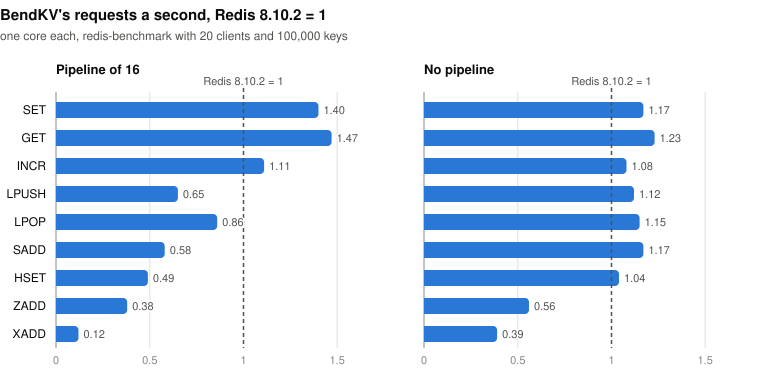

# BendKV

A Redis-compatible key-value server written in [Bend2](https://github.com/bendlang/bend),
whose core is formally verified.

BendKV answers as Redis 7.2.16 does, identically, for the commands it has: strings,
hashes, lists, sets, sorted sets, streams, HyperLogLogs and GEO with their times to live,
transactions, Pub/Sub, Lua scripts and functions, ACL users, the append-only file and the
RDB file. It speaks RESP2 and RESP3, so `redis-cli`, `redis-benchmark` and client
libraries work with it as they are.

Its central guarantees are proved against 68 laws:

- no command changes a key it does not write, neither its value nor its time;
- a key whose time has passed is gone;
- a pipelined batch runs exactly as its commands, one after another;
- the append-only file, as the server appends it, restores exactly the databases the
  server held, and a file cut by a crash at any byte restores them as they were after
  some prefix of what ran, with no transaction applied in part;
- a client that has not authenticated, where a password is set, can neither read nor
  change any key;
- GET, SET, DEL, APPEND, RENAME and the other string and key commands the laws name
  answer and write as specified.

Bend checks the proofs, and the BendTT kernel, whose soundness is proved in Lean, checks
them again. What the other commands answer is tested against a real `redis-server`. 
[What is proved](#what-is-proved) has the laws by group, and what they leave
out.

> **Status: research prototype.** Of the 1,812 tests of Redis 7.2.16's own suite that
> Redis passes against a server it did not start, BendKV passes 1,769, and it passes all
> but 2 of redis-py's tests and all of go-redis's
> ([docs/COMPATIBILITY.md](docs/COMPATIBILITY.md)). It has no replication and no cluster.
> Do not use it for data you cannot lose.

BendKV is an independent project. It is not affiliated with Higher Order Company or the
Bend project, nor with Redis Ltd. Redis is a trademark of Redis Ltd.

## Quick start

You need [Bun](https://bun.sh), clang 19 and Python 3.

```bash
git clone https://github.com/bendlang/bend ../bend-patched
sh bend-patches/apply.sh ../bend-patched        # Bend 2.0.35, with BendKV's patches
make build BEND="bun ../bend-patched/bend2/main.ts"
./build/bendkv --port 6380                       # redis-server's options and files work
redis-cli -p 6380 set greeting hello
redis-cli -p 6380 get greeting
```

[Building and running](#building-and-running) has the rest: checking the proofs, the
command line, and how replies go out.

## What works

Each area links to what [docs/COMMANDS.md](docs/COMMANDS.md) says of it: the commands
and their options, how each write is logged in the append-only file, and where BendKV
differs from Redis.

| area | commands |
|---|---|
| [Strings and keys](docs/COMMANDS.md#strings-and-keys) | GET, SET, MGET, MSET, INCR and its kin, APPEND, DEL, EXISTS, RENAME, COPY, KEYS, SCAN, RANDOMKEY, OBJECT |
| [Times to live](docs/COMMANDS.md#times-to-live) | EXPIRE and its kin, TTL, EXPIRETIME, PERSIST, the times of SET and GETEX; keys that expire are swept |
| [Ranges and bits](docs/COMMANDS.md#ranges-and-bits) | GETRANGE, SETRANGE, GETBIT, SETBIT, BITCOUNT, BITPOS, BITOP, LCS, BITFIELD |
| [Floats](docs/COMMANDS.md#floats) | INCRBYFLOAT and HINCRBYFLOAT, with the results of Redis's long doubles |
| [Hashes](docs/COMMANDS.md#hashes) | HSET, HGET, HMGET, HDEL, HGETALL, HINCRBY, HSCAN, HRANDFIELD and the rest |
| [Lists](docs/COMMANDS.md#lists) | LPUSH, RPUSH, LPOP, RPOP, LRANGE, LSET, LINSERT, LREM, LPOS, LMOVE, LMPOP and the rest |
| [Sets](docs/COMMANDS.md#sets) | SADD, SREM, SMEMBERS, SSCAN, SPOP, SRANDMEMBER, SMOVE, SINTER, SUNION, SDIFF and their STOREs, SINTERCARD |
| [Sorted sets](docs/COMMANDS.md#sorted-sets) | ZADD, ZINCRBY, ZRANGE in all its forms, ZRANK, ZPOPMIN, ZRANDMEMBER, ZUNION, ZINTER, ZDIFF, ZMPOP and the rest |
| [Sorting](docs/COMMANDS.md#sorting) | SORT and SORT_RO, with BY, GET, LIMIT, ALPHA and STORE |
| [HyperLogLogs](docs/COMMANDS.md#hyperloglogs) | PFADD, PFCOUNT, PFMERGE, PFDEBUG, PFSELFTEST, on the s Redis writes |
| [GEO](docs/COMMANDS.md#geo) | GEOADD, GEOPOS, GEOHASH, GEODIST, GEORADIUS, GEOSEARCH, GEOSEARCHSTORE |
| [DUMP and RESTORE](docs/COMMANDS.md#dump-and-restore) | payloads that are Redis's byte for byte, both ways |
| [Streams](docs/COMMANDS.md#streams) | XADD, XRANGE, XREAD, XTRIM, XDEL, XSETID, XINFO; consumer groups: XGROUP, XREADGROUP, XACK, XCLAIM, XAUTOCLAIM, XPENDING |
| [Clients that wait](docs/COMMANDS.md#clients-that-wait) | BLPOP, BRPOP, BLMOVE, BLMPOP, BZPOPMIN, BZPOPMAX, BZMPOP, XREAD and XREADGROUP with BLOCK |
| [Transactions](docs/COMMANDS.md#transactions) | MULTI, EXEC, DISCARD, WATCH, UNWATCH |
| [Pub/Sub](docs/COMMANDS.md#pubsub) | SUBSCRIBE, PSUBSCRIBE, SSUBSCRIBE, PUBLISH, SPUBLISH, PUBSUB; keyspace notifications |
| [Databases](docs/COMMANDS.md#databases) | 16 of them: SELECT, MOVE, SWAPDB, FLUSHDB, FLUSHALL |
| [Connection](docs/COMMANDS.md#connection) | PING, ECHO, TIME, HELLO, AUTH, QUIT, RESET, and CLIENT's commands of a connection |
| [Clients](docs/COMMANDS.md#clients) | CLIENT LIST, CLIENT INFO, CLIENT KILL |
| [CLIENT TRACKING](docs/COMMANDS.md#client-tracking) | client-side caching: keys, BCAST and prefixes, OPTIN and OPTOUT, redirection |
| [CLIENT PAUSE](docs/COMMANDS.md#client-pause-and-client-unpause) | CLIENT PAUSE WRITE and ALL, CLIENT UNPAUSE |
| [MONITOR](docs/COMMANDS.md#monitor) | each call's line, as Redis writes it |
| [ACL](docs/COMMANDS.md#acl) | users with selectors, key and channel patterns; ACL LOG, DRYRUN, GENPASS and the rest |
| [Scripts](docs/COMMANDS.md#scripts) | EVAL, EVALSHA and their `_RO` forms, SCRIPT, on Redis 7.2.16's own Lua |
| [Functions](docs/COMMANDS.md#functions) | FUNCTION LOAD, LIST, DUMP, RESTORE and the rest; FCALL, FCALL_RO |
| [SLOWLOG and LATENCY](docs/COMMANDS.md#slowlog-and-latency) | the slow log, the latency monitor and its histograms |
| [The server](docs/COMMANDS.md#the-server) | LASTSAVE, ROLE, WAIT, WAITAOF, SHUTDOWN, MEMORY, LOLWUT |
| [Configuration](docs/COMMANDS.md#configuration) | CONFIG GET, SET, RESETSTAT, over every parameter of Redis 7.2.16 |
| [Introspection](docs/COMMANDS.md#introspection) | INFO with Redis's sections and fields, COMMAND, the statistics of each command |
| [Memory](docs/COMMANDS.md#memory) | maxmemory and its eviction policies, OBJECT IDLETIME and FREQ |
| [Start](docs/COMMANDS.md#start) | `redis-server`'s command line and configuration file, and its log |
| [Protocol](docs/COMMANDS.md#protocol) | RESP2 and RESP3, pipelining, inline commands, Redis's limits on requests |
| [Persistence](docs/COMMANDS.md#persistence) | the append-only file, as one file or as Redis 7's directory, and BGREWRITEAOF; the RDB file: SAVE, BGSAVE, and the start from it |

What it does not have: replication (SYNC, REPLICAOF, MIGRATE), the cluster mode (CLUSTER
answers as Redis does with the cluster mode off) and modules (MODULE LOAD is refused);
and CONFIG REWRITE writes no file ([Not yet](docs/COMMANDS.md#not-yet)).

## How compatible it is

- **Redis 7.2.16's own test suite**, run against BendKV as against a server the suite did
  not start: BendKV passes 1,769 of the 1,812 tests that Redis passes there. Of the 43
  others, 29 stop on a command BendKV does not have, SYNC above all
  ([docs/COMPATIBILITY.md](docs/COMPATIBILITY.md), unit by unit).
- **Client libraries' test suites:** redis-py 8.1.0 passes 2,770 of the 2,772 tests that
  Redis passes, in RESP2 and in RESP3 alike, and go-redis v9.23.0 all 463
  ([docs/COMPATIBILITY.md](docs/COMPATIBILITY.md#client-libraries-test-suites)).
- **BendKV's own tests** send the same commands to BendKV and to a real `redis-server`
  7.2.16 and compare the replies byte for byte ([tests/README.md](tests/README.md)).

**Where BendKV differs.** Each area of [docs/COMMANDS.md](docs/COMMANDS.md) says where
BendKV answers otherwise than Redis 7.2.16, under "Where BendKV differs". The kinds that
come up most:

- where Redis answers in the order of one of its hash tables (a large hash or set, KEYS,
  a whole SCAN, PUBSUB CHANNELS), BendKV answers in the order of its own trie;
- a write that changes nothing (an SADD that adds no member, an LSET past a list's end)
  leaves a value's encoding as it was, where Redis has already converted it;
- the requests that come together share one time: MONITOR's lines, the slow log and the
  latency monitor see one time for all of them;
- the memory is BendKV's own: the same `maxmemory` holds another number of keys, and
  CLIENT LIST shows no output buffers;
- where Redis 7.2.16 has a bug, BendKV does not copy it ([docs/UPSTREAM.md](docs/UPSTREAM.md)).

## How fast it is

BendKV is measured against the newest servers, Redis 8.10.2 and Valkey 9.1.2, on the
same machine, one core each, with redis-benchmark's 20 clients and 100,000 keys. Each
number is a server's requests a second, with Redis 8.10.2's taken as 1: 1.40 is 40% more
requests a second than Redis 8.10.2 serves, 0.50 half as many.

<picture>
  <source media="(prefers-color-scheme: dark)" srcset="docs/img/speed-dark.svg">
  
</picture>

With a pipeline of 16:

| server | SET | GET | INCR | LPUSH | LPOP | SADD | HSET | ZADD | XADD |
|---|---:|---:|---:|---:|---:|---:|---:|---:|---:|
| **BendKV** | **1.40** | **1.47** | **1.11** | **0.65** | **0.86** | **0.58** | **0.49** | **0.38** | **0.12** |
| Redis 8.10.2 | 1.00 | 1.00 | 1.00 | 1.00 | 1.00 | 1.00 | 1.00 | 1.00 | 1.00 |
| Valkey 9.1.2 | 0.92 | 1.18 | 0.93 | 0.91 | 0.87 | 0.94 | 0.91 | 0.99 | 1.05 |
| Redis 7.0.15 | 0.90 | 0.97 | 0.80 | 1.09 | 0.95 | 0.89 | 0.89 | 0.82 | 1.01 |

Without a pipeline:

| server | SET | GET | INCR | LPUSH | LPOP | SADD | HSET | ZADD | XADD |
|---|---:|---:|---:|---:|---:|---:|---:|---:|---:|
| **BendKV** | **1.17** | **1.23** | **1.08** | **1.12** | **1.15** | **1.17** | **1.04** | **0.56** | **0.39** |
| Redis 8.10.2 | 1.00 | 1.00 | 1.00 | 1.00 | 1.00 | 1.00 | 1.00 | 1.00 | 1.00 |
| Valkey 9.1.2 | 0.98 | 1.03 | 1.12 | 1.04 | 1.09 | 1.04 | 1.04 | 0.93 | 0.96 |
| Redis 7.0.15 | 0.99 | 1.07 | 1.00 | 0.93 | 0.95 | 0.97 | 0.94 | 0.82 | 0.92 |

Redis 8.10.2's 1 is 730 thousand SETs and 797 thousand GETs a second with the pipeline,
112 and 103 thousand without it.

On strings BendKV runs fewer instructions a request than either (GET 3,570, against
4,430 for Redis 8.10.2 and 5,711 for Valkey); on collections it runs 1.3 to 2 times as
many, on ZADD 4.7 times and on XADD 7.6 times. On three cores without a pipeline it
serves as many GETs as Valkey with three I/O threads; with a pipeline, Redis and Valkey
spread the parsing and the replies over their I/O threads and serve a third more.
Section 94 of [docs/PERFORMANCE.md](docs/PERFORMANCE.md) has every number and how it was
taken. About 950 thousand keys with 3-byte values take 60 MB of resident memory, against
Redis 7.0.15's 121 MB. Lua scripts cost BendKV's actor several times Redis's work
(section 68).

Most of the speed came from fixing Bend, not BendKV: the first build ran at a tenth of
Redis's rate, and the patches to the Bend compiler and runtime in
[`bend-patches/`](bend-patches/) made up the difference
([docs/PERFORMANCE.md](docs/PERFORMANCE.md), "In short").

## Why

Most of a key-value server's semantics is a pure function
`exec(command, db) -> (reply, db')`, which is exactly what a proof assistant handles
well. BendKV asks how far one can get writing a real, fast server in a language where
the code that runs is the code that is proved, without a separate model and a
refinement proof. The answer so far: the verified core is not what makes it slow;
the data representation of the runtime was, and most of the work went into fixing it
(the patches to the Bend compiler in [`bend-patches/`](bend-patches/), counted in
[docs/NUMBERS.md](docs/NUMBERS.md): most speed up its data representation and its runtime, and
the others add what a server needs from the system, from the process's directory, id
and clock to the files it cuts, the heap's account and C's doubles, and one lets
AddressSanitizer check the heap).

## What is proved

The laws are stated in [`proof/LAWS.bend`](proof/LAWS.bend), where a human approves
every change, and proved in [`proof/PROOF.bend`](proof/PROOF.bend). A database is a
record: the trie, whose entries hold each key's value (a string, or a collection) and
the time it expires at; how many keys it holds (which
DBSIZE answers) and how many of them have a time; and the time its batch runs at. The
server holds several (16, as Redis), with the one a connection selected in focus while
its batch runs. A key whose time has passed is there for no command. The laws about what keys read and what
commands answer are stated of the server's commands and proved through a specification,
the commands on the trie alone at a time ([`proof/SPEC.bend`](proof/SPEC.bend)), which a
bridge in the proofs ties to the server's commands (DBSIZE answers the count); the
counts are proved to be the trie's own.

| group | laws | what they say |
|---|---:|---|
| Map | 11 | the trie is a finite map from keys to a value and a time: after any sequence of writes (a value with a time, a value with its time kept, a time alone, a deletion), every key holds what was last written to it, with no stale, lost or foreign entries; a read sees a key only until its time |
| Keys | 2 | key comparison is exactly string equality, down to the bits of `U32` |
| Commands | 24 | no command changes a key it does not write, neither its value nor its time (`frame`); reads keep the database (the commands of hashes, lists, sets and sorted sets, PFADD, PFCOUNT of one key and PFDEBUG are reads and updates of their key, LMOVE, LMPOP, SMOVE, ZMPOP and the operations of several sets and sorted sets of their keys, so these laws and those below hold of them); a key whose time has passed is there for no command, and the sweep of expired keys deletes no key that is there; GET, DEL, APPEND, SETRANGE, SETNX, INCR, GETDEL, PERSIST, PTTL, SET with KEEPTTL, RENAME, MSETNX and BITOP behave as specified, on keys of the types they take (SET, SETNX, the times and the key commands take any), a key they add counted; a pipelined batch runs exactly as its commands in order; the cache hints before a batch change nothing |
| Commuting | 5 | commands on different keys commute: replies and key contents are the same in either order, and adjacent independent commands in a batch can be swapped, when neither writes a key the other's writes depend on (RENAME moves a value from one key to another, MSETNX sets its keys only when none is there, BITOP sets its destination from its sources, LMOVE pushes onto its destination what it pops from its source, LMPOP pops from the first of its keys that is there, a STORE of a set operation sets its destination to what its sources make, SMOVE moves a member from its source to its destination, a STORE of a sorted-set operation or of a range sets its destination to what its sources or its source make, ZMPOP pops from the first of its keys that is there); SORT, whose patterns may read any key, swaps with reads alone |
| Persistence | 10 | logging changes no reply; the file reads back as written, times included; after any history, each batch at its own time, on any of the databases, the server restores exactly the databases it held; a file cut by a crash at any byte restores the databases after some prefix of its acts in which every transaction is whole, never a partial act or transaction; the start's replay, which first checks that each entry replays as written, is that replay whenever the check refuses none; the start, which reads its file a window at a time, makes of any windows what it makes of the whole file |
| Databases | 6 | SELECT changes no database and focuses the one it names; SWAPDB puts each of two databases in the other's place; FLUSHALL empties them all; MOVE takes a key's entry, its value and its time, out of the selected database and sets it in the other; COPY sets a key's entry at another key, in the selected database or another, when that key is not there or REPLACE is given |
| Key count | 2 | after any history, the counts every database keeps are its trie's own, how many keys it holds and how many of them have a time, and its trie holds each key once; so DBSIZE answers the number of keys in its trie |
| Sessions | 5 | however the server dispatches a batch, it runs as its commands in order; a batch changes the databases and the log as its executed commands do; a client that has not authenticated against a password cannot read or change any key |
| Configuration | 3 | a CONFIG SET that fails changes nothing; one that succeeds makes the new requirepass the password; after a CONFIG SET of a parameter, CONFIG GET finds the value its check gave |

`make check` takes about 15 s; `make verdict` rechecks every proof in the BendTT kernel
in about two minutes.

**Trust boundary.** The proofs cover `src/map.bend`, `src/redis.bend`, `src/batch.bend`,
`src/aof.bend`, `src/session.bend` and `src/config.bend`, the files the laws import
([docs/NUMBERS.md](docs/NUMBERS.md)). Trusted without proof: the Bend compiler and its C runtime
(with the patches); the RESP parser and the network shell (`src/resp.bend`,
`src/server.bend`), the start (`src/startup.bend`), INFO and COMMAND (`src/info.bend`,
`src/command.bend`), the doubles in software (`src/float.bend`, tested against glibc as
well), what HyperLogLogs, GEO and LOLWUT compute (`src/hll.bend`, `src/geo.bend`,
`src/lolwut.bend`) and DUMP's payloads (`src/rdb.bend`), all tested against
`redis-server`; the Lua engine of scripts: Redis 7.2.16's own Lua 5.1.5 and its libraries
(`deps/redis`, C, as Redis ships them but for their casts of numbers to integers, which
give Redis's results defined in C: NOTICE) and the glue that drives it
(`src/lua/engine.c`, ported from Redis's `script_lua.c`, `eval.c`, `script.c`,
`function_lua.c` and `functions.c`, behind the effects of `src/script.bend`); clang, libc
and the OS. This is not
end-to-end verification in the sense of CompCert or seL4; see
[docs/FINDINGS.md](docs/FINDINGS.md), section 1.

The BendTT kernel is proved sound in Lean, but the translation from Bend to the kernel
is not, and since Bend 2's release several bugs were reported in which `--verdict`
passes while the kernel checked something other than the source says
([#1186](https://github.com/bendlang/bend/issues/1186),
[#1236](https://github.com/bendlang/bend/issues/1236),
[#1247](https://github.com/bendlang/bend/issues/1247), open as of October 2026). None
of their triggers occurs in BendKV's proofs (no specialized parameters over empty types,
no law helpers named like Base constructors, no colon/dot name clashes), but the
translation stays in the trusted base.

## Building and running

You need [Bun](https://bun.sh), clang 19 (clang 18 works, about 8% slower), Python 3,
and Bend with the patches in [`bend-patches/`](bend-patches/) applied; `make verdict`
also needs Lean 4.34.0 (through elan).

```bash
git clone https://github.com/bendlang/bend ../bend-patched
sh bend-patches/apply.sh ../bend-patched      # Bend 2.0.35 and the patches
B="bun ../bend-patched/bend2/main.ts"

make check   BEND="$B"   # check the proofs
make verdict BEND="$B"   # ... and recheck them in the BendTT kernel
make build   BEND="$B"   # build/bendkv
make run                 # ./build/bendkv 6380
redis-cli -p 6380 set foo bar
```

`./build/bendkv [/path/to/redis.conf] [--name value ...] [-]` starts as `redis-server`
does (`./build/bendkv --port 7777 --appendonly yes`, `./build/bendkv /etc/redis/redis.conf`);
replies go out from a writer thread when the process has two cores or more (a client that
stops reading holds up only its own replies), and from the event loop with
`io-threads 1`. `./build/bendkv --help` lists the forms. The short form
`./build/bendkv PORT [post|send [FILE [always|everysec|no]]]` is BendKV's own: `post` or
`send` picks how replies go out, `FILE` (any path) turns on the append-only file; it
loads no RDB file.

## Testing

```bash
make smoke     BEND="$B"   # the pure path end to end and the append-only file, no network; fails on any mismatch
make test      BEND="$B"   # needs redis-server, redis-cli, redis-benchmark and a C compiler
make perfcheck BEND="$B"   # instructions, misses and prefetches per request against a baseline (needs valgrind)
make gencheck              # the generated parts (trie, its proofs, the parameter and command tables, the counts) are up to date
make bench     BEND="$B"   # redis-benchmark: BendKV against Redis
make suite     BEND="$B" REDIS_SRC=../redis   # Redis's own test suite, on Redis and on BendKV (needs tclsh)
make clients   BEND="$B"   # redis-py's and go-redis's test suites, on Redis and on BendKV (needs go)
```

`make test` sends the same commands to BendKV and to a reference `redis-server` 7.2.16 and
compares what they answer: random command streams, every data type at its edges and at
random, the protocol, the connections and clients, the configuration and the start,
scripts, and the append-only and RDB files, both servers starting from each other's
files. [tests/README.md](tests/README.md) lists every test, what it compares and how, and
how to run one alone. `make suite` and `make clients` run Redis's own test suite and the
client libraries' suites against both servers, and `tools/sanitize.sh` runs the tests
under AddressSanitizer, UndefinedBehaviorSanitizer and ThreadSanitizer.

CI runs the proofs, the pure checks, the build and `make perfcheck` on every push, and
`make test`, the client suites and the sanitizers before a pull request merges
([CONTRIBUTING.md](CONTRIBUTING.md)).

## Layout

The six files that the laws are about name the groups of [What is proved](#what-is-proved)
that state them; the others are tested against `redis-server`.

```
src/        the server
  map.bend      hash trie with string keys                         laws: Map, Keys, Key count
  float.bend    doubles and long doubles in software               tested
  hll.bend      HyperLogLogs on a string's bytes, as Redis's       tested
  geo.bend      geohashes, cells, distances and sorts, as Redis's  tested
  lolwut.bend   LOLWUT's drawings, as Redis draws them             tested
  rdb.bend      the RDB format: DUMP, RESTORE and the file         tested
  stream.bend   streams' nodes, as Redis's listpacks hold them     tested
  aofdir.bend   the manifest of Redis 7's append-only directory    tested
  redis.bend    command semantics: exec(cmd, db) -> (reply, db')   laws: Commands, Commuting, Databases
  batch.bend    a pipelined batch with cache hints                 laws: Commands (the hints)
  aof.bend      append-only file: effects, encoding, loading       laws: Persistence
  session.bend  connection and server state, whole batches         laws: Sessions
  config.bend   the parameters, CONFIG GET and SET                 laws: Configuration
  resp.bend     RESP parser, RESP2 and RESP3 reply encoders         tested
  info.bend     INFO's sections and fields, SLOWLOG, LATENCY        tested
  command.bend  COMMAND, with Redis's table of BendKV's commands     tested
  sha.bend      SHA-256, as Redis keeps a password's               tested
  acl.bend      ACL users: rules, checks and the log, as Redis's   tested
  startup.bend  the command line and the configuration file        tested
  script.bend   the effects of the Lua engine (src/lua/engine.c)   tested
  server.bend   TCP, connections, the database actor, the log      tested
  lua/          the engine's C: Redis's Lua driven in steps         tested
deps/redis/ Redis 7.2.16's Lua 5.1.5 with its libraries, and three of its helpers, as Redis ships them (NOTICE: their licenses, and the one change)
proof/      LAWS.bend (the laws), PROOF.bend (their proofs), SPEC.bend (the commands on the trie alone)
tests/      the tests and run_tests.sh, which runs them: tests/README.md lists them
bench/      in-process benchmarks of the map, the core and channels, and `make bench` against Redis
tools/      measurement scripts, the runners of Redis's test suite and of the client libraries'
            suites, and the generators of the trie, of the parameter table, of the command
            table and of the counts, with the facts they take from Redis (tools/data/)
bend-patches/  the patches to the Bend compiler and runtime
docs/       COMMANDS.md, COMPATIBILITY.md, UPSTREAM.md, FINDINGS.md, PERFORMANCE.md, DIRECTIONS.md,
            NUMBERS.md
```

## Documentation

**Using BendKV:**
- [docs/COMMANDS.md](docs/COMMANDS.md): every command, area by area, and where BendKV
  differs from Redis.
- [docs/COMPATIBILITY.md](docs/COMPATIBILITY.md): Redis's own test suite against BendKV,
  unit by unit, and why the tests it fails fail; the test suites of redis-py and go-redis.
- [docs/UPSTREAM.md](docs/UPSTREAM.md): the bugs of Redis 7.2.16 that BendKV does not copy.

**The research:**
- [docs/FINDINGS.md](docs/FINDINGS.md): what building BendKV and making it fast showed,
  one section for each change: what, why, and what it cost.
- [docs/PERFORMANCE.md](docs/PERFORMANCE.md): every optimization, section by section,
  with measurements.
- [docs/DIRECTIONS.md](docs/DIRECTIONS.md): verified databases, compilers, parallelism,
  and where the work goes next.
- [docs/BEND.md](docs/BEND.md): a review of Bend2 after BendKV: writing in it, how well
  the language is made, whether it suits coding agents, and what to change.
- [OVERVIEW.md](OVERVIEW.md): the full project report, including the feasibility study
  (SQLite, Redis, memcached, LMDB in Bend2) and Bend2's limitations met in practice.

**Working on BendKV:**
- [CONTRIBUTING.md](CONTRIBUTING.md): how a change is made, checked and documented.
- [AGENTS.md](AGENTS.md): the rules for coding agents: the laws, the checks, the merging.
- [tests/README.md](tests/README.md): the tests, and how to run them.
- [tools/README.md](tools/README.md): the generators and how everything was measured.
- [docs/NUMBERS.md](docs/NUMBERS.md): the counts the documents cite: laws, patches, lines
  of code of each file, written by `tools/gen_counts.py`.
- [bend-patches/README.md](bend-patches/README.md): the patches to the Bend compiler.

## Contributing

See [CONTRIBUTING.md](CONTRIBUTING.md), and [AGENTS.md](AGENTS.md) for coding agents.

## License

BendKV is licensed under the [Apache License, Version 2.0](LICENSE). It includes, and
ports code from, software under other licenses: Redis 7.0.15 and 7.2.16 (BSD 3-Clause),
Lua 5.1.5 and its libraries (MIT), and Bend, which `bend-patches/` changes (Apache 2.0).
[NOTICE](NOTICE) lists them file by file. Contributions come under BendKV's license
([CONTRIBUTING.md](CONTRIBUTING.md#license)).

Redis is a registered trademark of Redis Ltd. BendKV names Redis to say what it is
compatible with and what it is measured against; it is not affiliated with, or endorsed
by, Redis Ltd.
